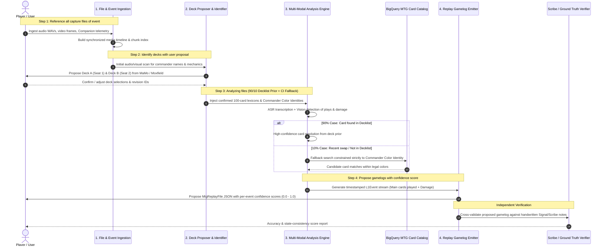
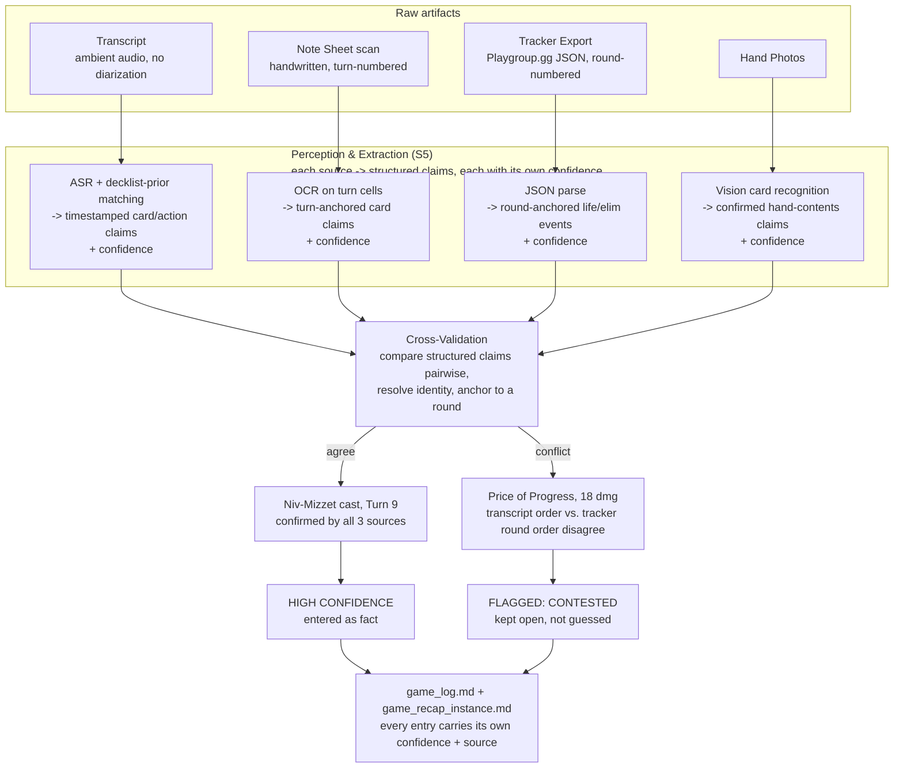

# Live Game Capture & Multi-Modal Gamelog Reconstruction Specification

## Architecture & Protocol Specification v1.0.0

**Status:** Draft / Active Specification  
**Published:** August 2026  
**Purpose:** Standardized specification and architecture for converting physical, live-played Magic: The Gathering games (audio, video, and companion telemetry) into structured, deterministic [MTG Replay Notation](./MTG-REPLAY-NOTATION.md) logs.

**Related Specifications:**
- [MTG Replay & Learning Notation v1.6.0](./MTG-REPLAY-NOTATION.md)
- [Commander Decklist Notation v1.2.0](./commander-decklist-spec.md)
- [MTG State Evaluation Framework](./mtg-state-evaluation-spec.md)

---

## 1. Executive Overview & Problem Statement

Physical tabletop Magic: The Gathering (specifically Commander and 1v1 formats) generates rich strategic decisions, but lacks automated digital telemetry. While digital platforms (e.g. Arena, Forge) produce native event logs, live games traditionally rely on manual scorekeeping or memory.

The **Live Game Capture Service** bridges this physical-to-digital gap. By fusing:
1. **Verbal audio declarations** (spells cast, triggers announced, phase changes, targets declared),
2. **Visual playmat state tracking** (overhead camera detecting card movements, tap/untap orientation, facedown cards),
3. **Decklist domain priors** (known 100-card Commander decklists with Scryfall/BigQuery Oracle IDs, card names, and mechanics),
4. **Companion app telemetry** (life changes, turn counters, manual card markings), and
5. **Game Notes / Scribe artifacts** (in-game shorthand notes, life checkpoints, player annotations, post-game debrief notes),

the service reconstructs a deterministic, timestamped **MTG Replay Notation** document (`MtgReplayFile` with `log_l1` events and `views_l2` decision snapshots) directly compatible with `new-backend`, `MaMoFrontend` replay viewers, and `mamo-story-engine`.

---

## 2. System Architecture

```
┌──────────────────────────────────────────────────────────────────────────────────────────────────┐
│                                       1. SENSORY INGESTION                                       │
├───────────────────┬───────────────────┬──────────────────────────┬───────────────────────────────┤
│    Audio Input    │    Video Input    │ Companion Telemetry Sync │   Game Notes / Scribe Stream  │
│(Room/Phone Mic WAV│(Overhead Playmat) │(Life/Turns/Drawn Check)  │(In-Game Notes/Debrief/Scribe) │
└─────────┬─────────┴─────────┬─────────┴────────────┬─────────────┴───────────────┬───────────────┘
          │                   │                      │                             │
          ▼                   ▼                      │                             │
┌───────────────────┐┌───────────────────┐           │                             │
│ 2. Biased ASR     ││ 3. Vision Tracker │           │                             │
│ (Whisper + Prompt)││(OCR, Taps, Zones) │           │                             │
└─────────┬─────────┘└────────┬──────────┘           │                             │
          │ Transcripts       │ Card Detections      │ Telemetry Anchors           │ Semantic Landmarks
          └─────────┬─────────┴──────────────────────┼─────────────────────────────┘
                    │                                │
                    ▼                                ▼
┌──────────────────────────────────────────────────────────────────────────────────────────────────┐
│                          4. MULTI-MODAL FUSION & STATE INFERENCE ENGINE                          │
│                                                                                                  │
│  ┌─────────────────────────┐  ┌──────────────────────────┐  ┌─────────────────────────────────┐  │
│  │   Decklist Priors &     │  │  NLP Action & Intent     │  │ Temporal Event Synchronizer &   │  │
│  │   BigQuery Oracle Index │  │  Extractor (German/EN)   │  │ Scribe Landmark Cross-Validator │  │
│  └────────────┬────────────┘  └────────────┬─────────────┘  └────────────────┬────────────────┘  │
│               │                            │                                 │                   │
│               ▼                            ▼                                 ▼                   │
│  ┌────────────────────────────────────────────────────────────────────────────────────────────┐  │
│  │                            MTG Game State Machine & Rules Solver                           │  │
│  │  - Cross-validates verbal claims against written scribe notes and life totals               │  │
│  │  - Validates legal transitions (mana, card ownership, priority, triggers)                   │  │
│  │  - Disambiguates facedown morphs/manifests using decklist identity + scribe annotations     │  │
│  │  - Fills unstated implicit game actions (untap step, state-based actions)                  │  │
│  └────────────────────────────────────────────────────────────────────────────────────────────┘  │
└────────────────────────────────────────────────┬─────────────────────────────────────────────────┘
                                                 ▼
┌──────────────────────────────────────────────────────────────────────────────────────────────────┐
│                              5. REPLAY NOTATION EMITTER & CONSUMERS                              │
│                                                                                                  │
│   MTG Replay Notation v1.6.0 (`meta`, `card_index`, `initial_state`, `log_l1`, `views_l2`)      │
│   - POST /api/gamelog/upload (new-backend Postgres + BigQuery association)                       │
│   - MaMoFrontend: Replay Player, Turn Explorer, Strategy Evaluation                              │
│   - mamo-story-engine: AI Narrative Prose & Scene Image Generation                               │
└──────────────────────────────────────────────────────────────────────────────────────────────────┘
```

---

## 2.1 Sequential Technical Flow



---

## 2.2 Technical Pipeline Breakdown

### Step 1: Reference All Capture Files of the Event
- Ingest and index all media components belonging to the match:
  - Audio WAV chunks with sample-rate normalization (e.g. 16kHz mono).
  - Overhead playmat video files / synchronized frame buffers.
  - Companion telemetry logs (turn increments, life total timestamps).
- Builds a unified multi-stream timeline: $T = [t_0, t_{\text{end}}]$.

### Step 2: Deck Identification & User Proposal
1. **Pre-scan**: Rapid keyword search across the initial audio/video segments for commander declarations (e.g. *"Kadena"*, *"Yuma"*, *"Davros"*, *"Mr. House"*).
2. **Proposal Generation**: Queries MaMo backend and Moxfield reference decks to present a candidate match setup:
   - Seat 1: `David` $\rightarrow$ Deck: `Kadena Morph` (Revision `rev-001`).
   - Seat 2: `Brother` $\rightarrow$ Deck: `Davros Dalek Clones` (Moxfield ID `xyz123`).
3. **User Confirmation**: The user confirms or adjusts the deck assignment before full multi-modal analysis begins.

### Step 3: Multi-Modal File Analysis (The 90/10 Rule & Color Identity Constraints)
- **90% Decklist Prior**:
  - The analysis assumes **$\ge 90\%$ of played cards exist in the confirmed decklist**.
  - ASR decoder and vision matcher prioritize the $\sim 100$ card entities of that player's deck.
- **10% Fallback (Color-Identity-Constrained BigQuery Search)**:
  - If a player plays a card not in the decklist (e.g. a recent card swap or tech choice):
  - The system initiates a fallback search against the complete BigQuery MTG Card Catalog (`magicmoments-442919.MtgCards.cards_transformed`).
  - **Constraint Rule**: The search is strictly filtered by the commander's **Color Identity**:
    $$\text{Card.ColorIdentity} \subseteq \text{Commander.ColorIdentity}$$
- **Critical Action Guarantee**:
  - Even if minor micro-actions (e.g. unannounced mana floating, priority passes) are omitted, the engine guarantees capturing:
    1. **Every main card played** (`PLAY_LAND`, `CAST`, `ACTIVATE`).
    2. **All damage created and life total changes** (`DAMAGE`, `LIFE`, `ATTACK`).

### Step 4: Propose Gamelog with Per-Entry Confidence Scores
- Reconstructs the game as a standard `mtg-replay` v1.6.0 document.
- **Confidence Scoring per Entry**: Every L1 event includes a `confidence` field ($0.0 - 1.0$) and `source` flags:
  ```json
  {
    "id": "evt_042",
    "timestamp": "20:45:12.300",
    "type": "CAST",
    "player": "P2",
    "card_name": "Phyrexian Metamorph",
    "confidence": 0.96,
    "source": "audio_declaration_and_vision_placement",
    "in_decklist": true
  }
  ```
- **Role of Game Notes**:
  - Game notes (from Signal or hand-written pads) are **not used during initial perceptual investigation**; they serve purely as **independent post-analysis verification** to measure reconstruction quality and benchmark model accuracy.

---

## 3. Sensory Ingestion Layer

### 3.1 Audio Capture & Chunking
- **Audio Channels**: 
  - Room ambient audio (e.g. 16kHz/48kHz WAV mono/stereo) or direct device recording from `mamo-companion`.
  - Continuous streaming or sliding chunks (e.g. 2-minute rolling buffers with 10-second overlap to prevent sentence boundary cutoff).
- **Acoustic Environment Handling**:
  - Voice Activity Detection (VAD) to filter background room noise and table shuffling.
  - Speaker diarization to attribute spoken declarations to Player seats (e.g. Seat 1: David, Seat 2: Opponent).
- **Known Limitation — No Working Diarization in Practice**: both archived room-mode datasets to date (`2026-08-28-session`, `2026-09-26-session`) were captured with a single ambient mic and carry **zero speaker labels** in the raw ASR output; diarization above is aspirational until Phase 6 hardware/software lands. Until then, the fusion engine MUST fall back to **Name-Mention Anchoring**: attribute an action to a player only when that player's name (or an unambiguous "du"/"you" addressed to a previously-named target) appears in the same or an adjacent utterance; otherwise emit the event with `player: "unattributed"` rather than guessing from turn-order heuristics or vocal-tone continuity. A 5-player, 3+ hour real session (`2026-09-26-session`) showed that guessing here produces confidently wrong attributions (see 3.5.1) that are worse than an honest "unattributed" tag.

### 3.2 Video Capture & Coordinate Normalization
- **Camera Position**: Top-down or high-angle angled webcam/phone camera covering the playmat.
- **Playmat Segmentation & Homography**:
  - Automatic or 4-point manual perspective correction warping the playmat into a canonical 2D coordinate grid.
  - Dedicated bounding zones per player:
    - `Zone_Battlefield_Active` (Creatures / Permanents)
    - `Zone_Lands` (Mana pool / Lands)
    - `Zone_Command` (Commander cards)
    - `Zone_Graveyard` & `Zone_Exile`
    - `Zone_Stack` (Center board for currently resolving spells)

### 3.2.1 Optical Barcode Scanning & Physical Slip-in Card Markers

#### 8×18 Data Matrix (ECC200) Slip-in Marker Architecture
For deterministic replay tracking, physical slip-in markers are placed in the card's extreme lower margin (inside the sleeve in front of the physical MTG card).

- **Physical Marker Sizing Profiles**:
  To ensure reliable scanning across diverse smartphone cameras (varying focal lengths and minimum focus distances) and sleeve materials (matte texture, glossy reflections), three standardized physical profiles are defined:

  | Profile | Total Dimensions (W × H) | Barcode Width | Module Size | Target Reading Distance | Card Sleeve Coverage |
  | :--- | :--- | :--- | :--- | :--- | :--- |
  | **Small (S)** | $15.6 \times 4.9\text{ mm}$ | $10.3\text{ mm}$ | $\sim 0.49\text{ mm}$ (28 mil) | $8 - 12\text{ cm}$ (macro required) | Fits 100% inside black border; covers zero card text. |
  | **Medium (M)** *(Recommended)* | $21.0 \times 6.8\text{ mm}$ | $14.3\text{ mm}$ | $\sim 0.68\text{ mm}$ (39 mil) | $15 - 25\text{ cm}$ (natural hand distance) | Covers bottom border + collector code; 100% rules text untouched. |
  | **Large (L)** | $27.0 \times 8.8\text{ mm}$ | $18.5\text{ mm}$ | $\sim 0.88\text{ mm}$ (50 mil) | $20 - 35\text{ cm}$ (rapid table scan) | High-speed macro detection under severe glare or low light. |

- **Optical Camera Constraint**:
  Standard smartphone camera lenses without dedicated macro hardware cannot sharply focus closer than $\sim 12\text{ cm}$. At 4.9 mm height, an 8×18 barcode's individual modules ($0.49\text{ mm}$) span fewer than 4 camera pixels when held at comfortable playmat distance, causing decode dropouts. **Profile Medium (6.8 mm height, module size $0.68\text{ mm}$)** is the proven operational sweet spot, locking on in $< 15\text{ ms}$ at 15–25 cm distance.

- **Payload Architecture Options**:
  1. **Option A: Deck Slot Number (`1`..`100`) (Current Baseline)**:
     - Encodes 1–3 numeric characters (e.g. `"1"`, `"15"`, `"100"`).
     - Fits comfortably into 8×18 Data Matrix (capacity: 10 alphanumeric / 16 numeric).
     - Preserves **individual object permanence** for identical duplicate basic lands (e.g. *Mountain #75* vs *Mountain #76*).
     - *Limitation*: Bound to that specific deck revision; slips cannot be freely swapped across decks.
  2. **Option B: Set Code + Collector Number (`<SET> <NUM>`, e.g. `"BLB 145"`)**:
     - Encodes 7–9 alphanumeric characters (e.g. `"C21 263"`, `"NEO 266"`).
     - Fits in 8×18 rectangular Data Matrix or 12×26 rectangular.
     - **Deck-Agnostic / Reusable**: A sleeved *Sol Ring* can be transferred into any deck without reprinting slips.
     - Cross-references directly to BigQuery catalog (`cards_transformed WHERE SetCode = 'c21' AND Number = '263'`).
     - *Limitation*: Duplicate basic lands share the same code unless a copy suffix is appended (`"BLB 266 #1"`).
  3. **Option C: Global Oracle Numeric ID (`1`..`35000`)**:
     - Encodes a 5-digit global card identifier.
     - Universal across all games and formats; compact payload fits 8×18.

- **Direct Card & Owner Resolution**:
  - Maps decoded payload directly to the active deck's card allocation table (`slot_numbers` or catalog entity), achieving $100\%$ identity confidence without OCR ambiguity.
  - Resolves player ownership and seat context from the pre-game Deck QR scan (`https://mamo.app/deck/<deck_id>`) or match lobby seat assignment.

---

### 3.2.2 Optical Full-Card Image Recognition with Decklist Prior & Verification Loop
For games played without physical slip-in Data Matrix markers, the capture service and `mamo-companion` support direct camera card recognition constrained by the known 100-card decklist prior:

- **Information-Theoretic Domain Constraint ($N=100$)**:
  - Open-universe card scanning requires searching against $\sim 35,000$ unique Oracle cards and $>100,000$ physical printings, demanding heavy vector indices or network round-trips.
  - By injecting the confirmed active decklist prior, candidate matching collapses to a closed set of $N \approx 100$ items (or $N \le 500$ across an entire 5-player pod). This achieves sub-15ms client-side execution, $<50\text{ KB}$ in-memory cache footprint, and $>98.5\%$ single-frame accuracy.
- **Multi-Face Card Decomposition Protocol**:
  - Cards containing the MTG face-separator (`//`) are decomposed into separate searchable in-memory entries:
    1. **Primary Face**: e.g. `"Toralf, God of Fury"` (`isSecondaryFace: false`)
    2. **Secondary / Back Face**: e.g. `"Toralf's Hammer"` (`isSecondaryFace: true`)
    3. **Adventure Sub-Spells & Split Halves**: e.g. `"Virtue of Courage"` vs. `"Embereth Blaze"`
  - Guarantees instant recognition regardless of whether a player casts the front creature face, activates the back equipment, or casts the adventure spell.
- **Three-Stage Cascaded OCR Matching Engine**:
  1. *Optical Normalization*: Case folding, stripping punctuation noise (`[^a-z0-9\s'/,-]`), and whitespace compression.
  2. *Stage 1 (Exact Clean Match)*: $O(1)$ string equality check against normalized face names (resolves 80% of clean scans in $<0.1\text{ ms}$).
  3. *Stage 2 (Prefix / Containment Ratio)*: Evaluates length-ratio overlap ($\ge 0.70$) for partial framing and card header crops.
  4. *Stage 3 (Fuzzy Approximate Bitap Match)*: Uses Fuse.js with distance threshold $0.40$ to tolerate character dropouts, motion blur, and common OCR character confusions (`0` vs `O`, `1` vs `l`, `c` vs `e`).
- **Catalog Multi-Printing Invariance**:
  - Across the user deck catalog in BigQuery, cards average **$11.1$ printings per card** (e.g. *Lightning Bolt* with 77 printings across 46 sets, featuring 30 distinct artist paintings).
  - While art-box feature matching (ORB/SIFT) fails whenever a player runs an un-indexed alternate art, retro frame, or Secret Lair printing, **Title-Bar OCR is 100% invariant across all physical printings and frames**.
- **The Duplicate Lands Limitation & Replay Object Permanence**:
  - In a Commander deck with 25 identical *Snow-Covered Mountains*, optical card vision reliably confirms card identity (*"Snow-Covered Mountain"*), but **cannot maintain persistent physical object permanence** across zones (differentiating Mountain #3 tapped on Turn 1 from Mountain #14 bounced on Turn 4).
  - *Design implication*: Full-card OCR serves as a zero-friction casual telemetry input; 8×18 Data Matrix markers remain required for strict deterministic object tracking (`c01`..`c100`) in full Replay Notation tournament archives.
- **Human Verification & Feedback Loop**:
  - To prevent erroneous state transitions from false-positive OCR hits, every optical recognition event provides immediate user feedback:
    - `✓ Right`: Records verified true positive and increments live session precision score.
    - `✕ Wrong`: Flags false positive, opening a deck correction selector to record the actual intended card name (`actualCardName`).
  - Emits standardized claims into the Multimodal Extraction pipeline:
    ```json
    {
      "claim_type": "CARD_RECOGNITION",
      "subject": "P1",
      "value": "Lightning Bolt",
      "confidence": 0.98,
      "source": "optical_card_recognition",
      "anchor": { "kind": "companion_timestamp", "value": "12:04:15.200" },
      "verified_by_user": true,
      "matched_face": "Lightning Bolt",
      "is_secondary_face": false
    }
    ```
  - The live session audit scorecard tracks real-time precision: $P = \frac{\text{Correct}}{\text{Total Verified}}$, allowing players to review or reset recognition trials during play.

### 3.2.3 Multi-Modal Feature & Confidence Score Fusion
While title-bar OCR provides the primary invariant text anchor across all 16,500 catalog printings, relying exclusively on OCR is vulnerable to sleeve reflections, glare, motion blur, partial finger occlusion, and character confusions (e.g. `O` vs `0`, `rn` vs `m`).

To maximize recognition confidence and eliminate false positives, the capture engine fuses **four visual perceptual channels** with a **game-state Bayesian prior**:

1. **Title OCR ($S_{\text{ocr}}$, weight $w_{\text{ocr}} = 0.45$)**:
   - Normalized Levenshtein distance and Bitap fuzzy search against primary and secondary face titles in the deck.
2. **Card Frame Color & Border Profile ($S_{\text{frame}}$, weight $w_{\text{frame}} = 0.20$)**:
   - Evaluates HSL color distribution of the card border and inner pinlines (White, Blue, Black, Red, Green, Gold/Multicolor, Brown/Artifact, Gray/Land).
   - Instantly filters out impossible color candidates (e.g. rejects a green card in a mono-red deck or distinguishes an artifact frame from a colored spell).
3. **Mana Cost & Symbol Detection ($S_{\text{mana}}$, weight $w_{\text{mana}} = 0.20$)**:
   - Template matching on the top-right header margin:
     - Generic mana numeral in circular gray bubble (e.g. $\{1\}, \{2\}, \{3\}$).
     - Colored mana pip icons ($\{W\}, \{U\}, \{B\}, \{R\}, \{G\}, \{C\}$).
   - Validates that detected mana pips match the candidate card's `ManaCost` string.
4. **Art-Box Color Palette Vector ($S_{\text{palette}}$, weight $w_{\text{palette}} = 0.15$)**:
   - Computes a coarse 16-bin 3D color histogram of the art window ($y \in [0.12, 0.55]$).
   - Cross-references the palette vector against the specific printing assigned in the deck revision.
5. **Game-State Bayesian Legality Prior ($P(\text{legality})$)**:
   - Evaluates real-time contextual plausibility using companion telemetry:
     $$P(\text{legality}) = P(\text{mana\_available}) \times P(\text{zone\_legality}) \times P(\text{copies\_remaining})$$
     - $P(\text{mana\_available}) \approx 0.05$ if the card's mana value exceeds the player's total untapped lands/mana sources.
     - $P(\text{copies\_remaining}) = 0.00$ in singleton Commander if the card is already on the battlefield, in exile, or in the graveyard.
     - $P(\text{turn\_phase}) \approx 0.10$ for Sorceries during opponent turns or combat steps (without flash enablers).

#### Comprehensive Fused Confidence Formula
The overall confidence score $C_{\text{fused}} \in [0.0, 1.0]$ is computed as:
$$C_{\text{fused}} = \Big( w_{\text{ocr}} S_{\text{ocr}} + w_{\text{frame}} S_{\text{frame}} + w_{\text{mana}} S_{\text{mana}} + w_{\text{palette}} S_{\text{palette}} \Big) \times P(\text{legality})$$

#### Decision Thresholds
- **HIGH Confidence ($C \ge 0.85$)**: Direct auto-match; triggers immediate telemetry logging and haptic confirmation.
- **MEDIUM Confidence ($0.60 \le C < 0.85$)**: Prompts player with the top 2 candidate cards for single-tap confirmation.
- **LOW / UNRECOGNIZED ($C < 0.60$)**: Flags recognition failure, saves frame for dataset harvesting, and prompts manual deck search.

---

### 3.2.4 Active-Learning Failure Dataset Storage & Harvesting
To continuously improve the recognition engine and adapt to real-world camera noise (glare, matte sleeve texture, foil curling, poor lighting, foreign-language printings), `mamo-companion` implements an automated on-device failure-harvesting loop:

1. **Camera Frame Persistence**:
   - When a card photo is captured via the camera viewfinder, the high-resolution frame is stored in the local app directory (`mamo_card_captures/` under `FileSystem.documentDirectory`).
2. **Capture Classification Taxonomy**:
   - Each capture is assigned one of three lifecycle statuses:
     - `RECOGNIZED`: Confidently matched card, awaiting or verified by player.
     - `UNRECOGNIZED`: No card candidate exceeded the confidence threshold ($C < 0.60$). Full frame preserved specifically as an edge-case training sample.
     - `FLAGGED_WRONG`: The vision engine predicted card $A$, but the user marked `✕ Wrong` and selected card $B$ via the correction modal. This provides ground truth for hard negative calibration.
3. **Manifest Schema (`mamo_card_captures_manifest_v1`)**:
   - Captures are cataloged in an on-device JSON manifest persisted via `AsyncStorage`:
     ```json
     {
       "id": "cap_1728643200000_a8f9",
       "timestamp": 1728643200000,
       "imageUri": "file:///data/user/0/.../mamo_card_captures/flagged_wrong_cap_1728643200000.jpg",
       "deckId": "970da44b-6801-493a-84ab-ad5a7a2940a9",
       "status": "FLAGGED_WRONG",
       "queryText": "Ashling Flmae",
       "predictedCard": "Ashling, Flamekin Scroller",
       "actualCard": "Ashling the Pilgrim",
       "confidence": "MEDIUM",
       "score": 0.72,
       "userVerified": true
     }
     ```
4. **Dataset Export & Active-Learning Feedback**:
   - The Verification Audit modal in `mamo-companion` exposes an **"📤 Export Captured Training Dataset"** action.
   - Invokes `exportCapturesManifest()`, bundling the JSON manifest and file references for export via `expo-sharing` (airdrop, email, Signal, Google Drive).
   - This dataset directly feeds the computer vision training pipeline to fine-tune edge weights, calibrate OCR confusion matrices, and improve multi-printing feature robustness.

### 3.2.5 Implementation Status & Strategic Decision: Slip-in Markers vs. Optical Full-Card Recognition

#### Current Implementation Status (Completed in `mamo-companion`)
The multi-modal optical card recognition system has been fully implemented, integrated, and verified in the companion codebase:
- **Client Recognizer**: Cascaded Bitap fuzzy OCR with primary-face priority matching against the active decklist ($N \le 100$, sub-15ms execution).
- **Human Verification Loop**: Live audit scorecard tracking precision with real-time `✓ Right` / `✕ Wrong` feedback and actual card correction selector.
- **Active-Learning Capture Engine**: Local device storage (`mamo_card_captures/`) recording camera frames with `RECOGNIZED`, `UNRECOGNIZED` (lighting/glare edge cases), and `FLAGGED_WRONG` (hard negatives with ground truth).
- **Offline Fixture**: Bundled 138-card database fixture for *SMMR: Freedom through Destruction (Ashling)* (`970da44b-6801-493a-84ab-ad5a7a2940a9`).
- **Test Suite**: 13 Jest test suites passing (145/145 tests).
- **Live User Test**: Expo Metro dev server deployed on LAN (`exp://192.168.178.175:8081`).

#### Strategic Comparison & Why Slip-in Markers Remain Primary
While optical full-card image recognition provides low-friction scanning for casual sessions and decklist verification, **physical slip-in Data Matrix markers remain the foundational standard for deterministic Replay Notation**:

| Dimension | Optical Full-Card Recognition | 8×18 Slip-in Data Matrix Markers |
| :--- | :--- | :--- |
| **Object Permanence** | **Fails on duplicates**: Cannot distinguish between 25 identical *Snow-Covered Mountains* tapped/bounced across turns. | **100% Deterministic**: Every physical card has a unique slot ID (`#1`..`#100`). Object permanence is preserved across all zones. |
| **Sleeve Glare Immunity** | **Medium-Low**: Title-bar OCR and art-box histograms degrade under overhead spotlight glare and glossy sleeves. | **High**: High-contrast matte white badge with ECC200 error correction decodes under steep angles and glare. |
| **Battlefield Occlusion** | **Vulnerable**: Dice, ability counters, and overlapping cards hide the card header or art box. | **Protected**: The compact slip sits in the card's extreme lower margin (black border), fully exposed when cards are fanned or tapped. |
| **Scan Speed & Latency** | $15 - 50\text{ ms}$ processing per frame + fuzzy scoring. | $< 2\text{ ms}$ native barcode scan hardware decode. |
| **Player Setup Effort** | Zero physical prep (uses raw cards). | Requires 1-time printing and sliding cut slips into sleeves. |

#### Conclusion & Current Focus:
Optical card recognition is retained in `mamo-companion` as an auxiliary casual logger and active-learning dataset harvester. Core replay tracking returns to **Physical Slip-in Markers**, specifically calibrating barcode sizing (Small: 4.9mm, Medium: 6.8mm, Large: 8.8mm) and payload compactness to guarantee instantaneous mobile camera scanning.

---

### 3.3 Companion Telemetry Stream
- Real-time event timestamps sent from `mamo-companion`:
  - `TURN_CHANGED` (turn number, active player index)
  - `LIFE_UPDATED` (player ID, old life, new life, delta)
  - `POISON_ADDED`, `COMMANDER_DAMAGE_ADDED`
  - `CARD_DRAWN_MARKED`, `CARD_USEFUL_MARKED`
- These telemetry points serve as **high-confidence anchor timestamps** to synchronize audio-visual event inference.

### 3.4 Game Notes & Scribe Artifact Ingestion
Players frequently jot down in-game shorthand, turn notes, or post-match summaries (e.g. *"Warte, ich muss erst mal was schreiben: Plateau, Soaring... "* or logging commander casts and life milestones). These notes serve as a critical quality multiplier:
- **Formats Supported**:
  - **In-App Companion Notes**: Timestamped turn notes typed during play (`CompletedGame.notes`, `sessionNotes`).
  - **Structured Scribe Text / Markdown**: Scribe logs containing turn markers (`T1: Plateau -> Sol Ring`, `T4: Davros cast`, `T7: Phyrexian Metamorph -> Dalek Drone`).
  - **Post-Game Debrief Annotations**: Retrospective notes recorded immediately after match completion (e.g. winner, final turns, key combos).
- **Signal Value**:
  - Provides **ground-truth sequence landmarks** to disambiguate periods of quiet play, background noise, or overlapping speech.
  - Exposes **hidden/private information** intentionally recorded by the player (e.g. card tutored to hand, facedown morph card identity).

### 3.4.1 Standardized Printable Telemetry Sheet (Commander Game Note Sheet)
For players opting for low-friction physical analog logging during tabletop Commander games (especially when life totals, pod damage, and standings are managed digitally via companion apps such as **Playgroup.gg**), MaMo provides an integrated, printable personal telemetry half-sheet:

- **Format & Layout**: Standardized **DIN A5 half-sheet (148 × 210 mm)**. Available as:
  - *Page 1 (2-Up)*: Two complete game logs side-by-side on standard DIN A4 landscape (297 × 210 mm) with a central dashed cut line (`x = 148.5 mm`).
  - *Page 2 (Standalone)*: Single DIN A5 portrait layout formatted for small clipboards, A5 paper trays, or digital e-ink tablets (e.g. iPad, reMarkable).
- **Application Integration**: Downloadable directly within `MaMoFrontend` via **Deck Finishing** > **Command Tower** dropdown (`Data & Print` > `📋 Game Note Sheet (PDF)`), and permanently hosted at `/templates/commander_game_note_sheet_a5.pdf`.
- **Recorded Fields & Schema Mapping**:
  1. **Minimal Header**: `DECK`, `DATE`, `MATCH #`.
  2. **Starting Hand Box (8 Cards)**:
     - `Mulligan down to: [   ]`: Write-in box for final kept card count.
     - `Opening Lands: [   ]`: Initial mana base count.
     - `Slots 1–8`: Two 4-column rows (Slots 1–4 and 5–8) capturing the 7-card opening hand plus the guaranteed Turn 1 draw step (or partner commanders).
  3. **Turn-by-Turn Action Table (Turns 1–14)**:
     - `TURN`: Round indicator (`T 1` .. `T 14`).
     - `CARDS DRAWN`: Dotted handwriting baseline for drawn cards or velocity (`+1`, `+3`). Cards in hand are derived deterministically as $(\text{Total Drawn} - \text{Total Played})$.
     - `LAND PLAYED`: Dotted baseline for land drops.
     - `CARDS PLAYED (Name / #)`: Dual baselines for cast spells or 8×18 Data Matrix slot numbers (`#1..#100`).
     - `KEY ACTIONS / COMBAT / NOTES`: Dual baselines for combat attacks, targets, triggers, and counterspells.
  4. **Post-Game Notes & Deck Tuning**:
     - `MVP (Name or Slot #)`: Card that overperformed or enabled the win condition.
     - `Cut Candidate (Name or Slot #)`: Underperforming card or dead draw.
- **Multimodal Reconstruction Role**:
  - The rigid, bounding-box-aligned geometry enables mobile camera capture and OCR segmentation (`scripts/ocr_signal_game_notes.py`), feeding verified turn anchors directly into the Multimodal Fusion & State Inference Engine.
- **Real-World Legibility Finding** (from a filled `2026-09-26-session` scan, cross-referenced into `playgroup_ground_truth.json`): handwriting legibility is bimodal, not uniform. Isolated, one-word entries in the `KEY ACTIONS` cell (a commander name, a single standout card, a bolded word like "BOOM") transcribe with high confidence even from messy cursive, because there is only one candidate token to disambiguate and the decklist prior (S4.1) constrains it further. Dense multi-card `CARDS PLAYED` cells on a busy turn do not: several entries per box, abbreviated names, and cramped handwriting pushed confidence to "not reliably extractable" on roughly half the sheets in that scan. **Design implication**: an OCR/vision pass over this sheet should be weighted as a source of high-confidence turn anchors and standout key actions (on par with a telemetry timestamp, §3.3), not as a complete substitute for the audio/vision per-card action stream - treat sparse-but-confident sheet data as a corroborating anchor to snap the fusion timeline to, the same role scribe notes already play in §4.3, rather than as a dense primary source.

### 3.4.2 Game State Evaluation Sheet (End-of-Round Table Discussion & Vector Rankings)
To evaluate multiplayer board progression, relative advantages, and game dynamics without cluttering personal deck notes, MaMo provides a dedicated companion sheet for end-of-round table discussions:

- **Format & Layout**: Standardized **DIN A5 Landscape (210 × 148 mm)**. Formatted as:
  - *Page 1 (2-Up)*: Two complete game state sheets top-and-bottom on standard DIN A4 portrait (210 × 297 mm) with a central dashed cut line (`y = 148.5 mm`).
  - *Page 2 (Standalone)*: Single DIN A5 landscape page for native A5 printing or digital stylus tablets.
- **Application Integration**: Downloadable via **Deck Finishing** > **Command Tower** dropdown (`Data & Print` > `🎯 Game State Evaluation Sheet (PDF)`), hosted at `/templates/commander_game_state_evaluation_sheet_a5.pdf`.
- **Recorded Fields & Schema Mapping**:
  1. **Pod Seating & Identification**: Assigns seat numbers: `P1 (You)`, `P2 (Left)`, `P3 (Across)`, `P4 (Right)` with player/commander names.
  2. **Early Game Development Block (Rounds 1–2 Side-by-Side)**:
     - Focuses exclusively on **Resource Potential** (mana base, lands, rocks, dorks, ramp acceleration).
     - R1 & R2 are placed side-by-side to optimize sheet space since complex combat, engines, and lethal threats have not yet developed.
     - Inside each round: 4 ranked rows (`1: P[ ]`, `2: P[ ]`, `3: P[ ]`, `4: P[ ]`) with generous note space for ramp cards (e.g. *Sol Ring*, *Mana Crypt*, *dork*, *missed land*).
  3. **Full State Evaluation Table (Rounds 3–10)**:
     - Four full state vector columns corresponding to the [MTG State Evaluation Framework](./mtg-state-evaluation-spec.md):
       - `RESOURCE POTENTIAL`: Mana production capacity & card advantage / hand size (Dimension 1 & 4).
       - `BOARD PRESENCE`: Battlefield footprint, power/toughness, blocker density (Dimension 2).
       - `DECK SYNERGY`: Engine assembly stage, active formations, archetype cohesion (Dimension 9 & Section 7).
       - `THREAT POTENTIAL`: Lethality clock, burst damage, inevitability / archenemy status (Dimension 5 & 10).
     - Inside each category cell: 4 dedicated rows for player ranking (`1: P[ ]`, `2: P[ ]`, `3: P[ ]`, `4: P[ ]`) with dotted lines for key reasons / permanents (e.g. `Rhystic`, `8 pwr`, `sac loop`, `lethal clock`).
- **Evaluation Framework Alignment**:
  - The turn-by-turn ordinal rankings $[\text{Rank}_{\text{Res}}, \text{Rank}_{\text{Brd}}, \text{Rank}_{\text{Syn}}, \text{Rank}_{\text{Thr}}]$ feed directly into the State Evaluation Framework's vector dominance and relative player advantage models.

### 3.5 Third-Party Digital Life-Tracker Cross-Validation (e.g. Playgroup.gg)

**Pattern derived from the `2026-09-26-session` dataset.** A large share of Commander pods already run a phone/tablet life-counter app (Playgroup.gg, or similar) alongside physical play, purely for life totals and turn timing — independent of any MaMo integration. Where the host or a player exports that app's own timeline/event log, it is a **near-zero-cost, high-confidence telemetry source** and should be ingested on par with (arguably above) Companion Telemetry Sync (§3.3), because it already exists without any capture-pipeline effort:

- **What it reliably provides**: exact life deltas per event, elimination order, the declared winner, and — critically — an unambiguous **game/match boundary** (one tracker "game" record = one physical game, regardless of how the room's conversation flows around it).
- **What it does not provide**: card names, spell/ability causality, or turn phase — it is a life/round skeleton, not a replay. It complements rather than replaces audio/vision perception.
- **Primary use in the Fusion Engine (§6)**:
  1. **Life-total resolution**: when audio/vision disagree or are silent on a life change, the tracker's logged delta is authoritative.
  2. **Elimination order & winner**: use the tracker's `ELIMINATED`/`GAME_END`/`lost the game` events as ground truth in preference to inferring "who died when" from combat banter.
  3. **Game-boundary correction**: treat a single tracker game record as one game, full stop. Do not let a lull in audio, a snack break, or an off-topic tangent (§3.6) be misread as a new game starting — that mistake is exactly what happened on first pass with the `2026-09-26-session` dataset, which was originally (and wrongly) split into two separate "games" around a conversational gap that a Playgroup.gg export later proved was mid-game.
- **Player-identity caveat**: third-party tracker usernames are **not** pre-mapped to MaMo user IDs or real names. Only a player who is independently confirmed (e.g. their own MaMo account, matched by email/login) can be resolved automatically; other seats' usernames should be carried through as opaque labels and only resolved to real names via explicit user confirmation (Step 2 of §2.1), never guessed from audio nicknames alone.
- **Reference fixture**: `testing/fixtures/live-capture/2026-09-26-session/playgroup_ground_truth.json` — a structured extraction of one such export, including an `audio_cross_references` block showing exactly where the audio-only reconstruction was corrected once this source was available. Treat this file the same way `replays/*.json` is used for the `2026-08-28-session` dataset (§8): as a benchmark target, not a training input.

#### 3.5.1 Case Study: What Went Wrong Without It

Before the tracker export was cross-referenced, the audio-only reconstruction of `2026-09-26-session`:
1. Split one continuous 5-player game into two separate "games" at a conversational lull, because Niv-Mizzet/Kenrith (present the whole game) only became audibly central late, and no audio signal marked a new game starting (no mulligan/shuffle dialogue, no reset chatter).
2. Misattributed a heard elimination line — `"Joni, du bist tot übrigens"` — to the wrong point in the game's actual timeline, purely because it had no way to anchor a spoken line to a specific tracker-confirmed round without diarization or a name→username mapping.
3. Assumed the player heard saying `"du hast noch zwei Leben"` (2 life) had lost, when the tracker showed that player's subsequent small-heal pattern and eventual win — audio alone captures a moment, not its outcome.

The mechanism this argues for isn't "combine four sources" — it's that **raw artifacts must be reduced to comparable structured claims before anything can be cross-validated**, and that **agreement and conflict must then be handled differently**, not silently merged. The extraction step is §5 (Perception & Action Extraction), applied separately per source — cross-validation in §6 never touches raw audio or a raw image directly, only the structured claims §5 already pulled out of them:



**Every extractor emits the same shape of object, regardless of source.** Cross-validation can only compare claims pairwise (§6) if they already agree on structure — confidence and provenance are metadata the extractor attaches at emission time, not something inferred later by whatever consumes the claim:

```json
{
  "claim_type": "CAST | DAMAGE | LIFE_CHANGE | ELIMINATION | HAND_CONTENTS | GAME_END",
  "subject": "<player>",
  "target": "<player | null>",
  "value": "<card name | amount | outcome>",
  "anchor": { "kind": "audio_timestamp | sheet_turn | tracker_round", "value": "..." },
  "confidence": 0.0,
  "source": "transcript | note_sheet | tracker_export | hand_photo",
  "evidence": "<verbatim quote | OCR text | raw JSON field this was derived from>"
}
```

This isn't hypothetical — `playgroup_ground_truth.json`'s `log_l1` array already emits exactly this shape (`round`, `type`, `source_player`/`target_player`, `amount`, `confidence`, `source`), and it's what let this session's cross-validation actually run: every claim carrying its own `anchor.kind` is precisely what stopped tracker rounds, sheet turns, and audio timestamps from being silently treated as one clock (see §3.5's counter-axis note). A claim missing `confidence` or `anchor` can't be cross-validated at all — it can only be trusted or discarded wholesale, which is the failure mode §3.5.1 above describes.

A confirmed fact becomes an entry; a conflict between two independent sources (right branch — the actual Price-of-Progress round-boundary contradiction from this session, still unresolved as of this writing) is flagged and left open rather than picked one way and asserted with the same confidence as everything else. This is the property a single-source pipeline (audio-only, or even audio+decklist-prior) cannot have: it has no second opinion to disagree with itself.

**Why the extraction layer matters as its own step, not just a detail of §5**: `2026-09-26-session`'s `game_notes_scribe.md` is a concrete example of skipping it. That file goes straight from raw transcript to narrative prose — no intermediate structured claims (no per-fact timestamp, turn, or confidence) survive into it, so nothing in it could be checked against the tracker export or the note sheet once those became available. It isn't a "Scribe" input in this pipeline's sense (§3.4's Scribe channel is independent player-authored shorthand used to *verify* a reconstruction, e.g. a terse `T1: Plateau -> Sol Ring`); it's what this same session's audio produces *without* the extraction step, and it carries the identical errors item 1-3 above describe — the 3-game split and the collapsed finish. Treat it as the "before" baseline this diagram's right-hand path exists to avoid, not as a fifth trusted source.

None of these were ASR quality failures (the actual card names and quotes transcribed correctly, see §4.3's homophone table for confirmed accurate resolutions from this same session: Karn/"Kahn", Pernicious Deed/"Precious Deeds", Niv-Mizzet/"Nif", Kenrith/"Ken Riff", Fatestitcher/"Fade Stitcher", Sigarda's Aid/"Zigardas-Aid"). They were **structural** failures — the kind only a second, independent event source can catch. This is the core argument for building tracker cross-validation into the pipeline rather than treating audio+decklist-prior ASR as sufficient on its own.

### 3.6 Non-Game Content Segmentation & Redaction

Room-mode ambient capture, by construction, keeps recording after the game ends and during any lull inside it. The `2026-09-26-session` dataset (a ~6-hour continuous capture) contained substantial stretches of pre-game banter, mid-session personal/family/political conversation, and — after the final game ended — several minutes of multilingual family conversation (English/Russian/Portuguese) unrelated to Magic in any way. None of this is useful signal for state inference, and some of it is content the players and bystanders did not consent to having retained as a "Magic session" artifact.

- **Pipeline requirement**: before persistence or display, classify each transcript window as `IN_GAME` vs. `OFF_TOPIC` (a cheap classification pass — presence of card names via decklist-prior lexicon, MTG action verbs, or turn-structure cues is a strong signal) and exclude `OFF_TOPIC` windows from both the state-inference engine's input and any long-term storage/display surface.
- **Do not use topic changes as game-boundary signals** — see §3.5's game-boundary correction above; a switch to off-topic conversation and back does not imply a new game.
- **Storage/consent implication**: raw audio and full transcripts of an ambient capture are a superset of "the game" and must be handled accordingly (e.g. not swept into a shared repo's git history via a broad `.gitignore` exception) until a redaction pass has run. This is a process gap identified during `2026-09-26-session` intake, not yet a pipeline stage — see [live-capture-progress.md](./live-capture-progress.md).

---

## 4. Domain Prior & Lexicon Biasing

Natural speech in Magic games is filled with jargon, shorthand, and multi-lingual mixing (e.g. German conversational syntax mixed with English MTG card names and keywords).

### 4.1 Dynamic Decklist Lexicon Injection
Before game ingestion begins, the session resolves the active decklists for all seats from `new-backend` / `mamo-types`:
```json
{
  "players": {
    "P1": {
      "deck_id": "deck-uuid-1",
      "deck_name": "Kadena Morph",
      "cards": ["Trail of Mystery", "Reluctant Roleworker", "Qarsi Deceiver", "Ainok Survivalist", "Deserted Beach", "Underground Sea", "Ugin's Mastery"]
    },
    "P2": {
      "deck_id": "deck-uuid-2",
      "deck_name": "Davros Dalek Clones",
      "cards": ["Davros, Dalek Creator", "Dalek Drone", "Phyrexian Metamorph", "Court of Vantress", "Training Center", "Sulfur Falls"]
    }
  }
}
```

### 4.2 ASR Context Biasing
1. **Vocabulary Prompt Injection**: The combined unique list of card names, mechanic keywords (`morph`, `manifest`, `monarch`, `cascade`, `connive`), and player names are fed into the speech-to-text decoder prompt (e.g. Whisper `initial_prompt` or decoding vocabulary constraint).
2. **Fuzzy Phonetic Matching**:
   - Phonetic representations (Double Metaphone / Soundex) match mispronounced or accented card names (e.g., German pronunciation of *"Trail of Mystery"*, *"Court of Vantress"*, *"Blasphemous Act"* / *"Blasphälose"*).

### 4.3 Notes-Driven Disambiguation & Cross-Validation
Written notes act as an authoritative tie-breaker for ambiguous phonetic transcriptions:
- If ASR transcribes *"Soaring"* or *"Radgau"*, but the game note contains `Sol Ring` and `Ragavan`, the fusion engine automatically resolves the card entity to `Sol Ring` / `Ragavan, Nimble Pilferer`.
- If audio volume drops during combat, written life changes (e.g. `P2: 40 -> 34`) confirm combat damage amounts.

---

## 5. Perception & Action Extraction

### 5.1 Verbal Dialogue Parsing
The Natural Language Action Extractor converts transcribed utterances into candidate intent objects:

| Spoken German Dialogue Example | Extracted MTG Action Candidate | Target Event Type |
|---|---|---|
| *"Ich spiele eine Flooded Grove, tappe die beiden um Trail of Mystery reinzubringen"* | Player 1 plays land `Flooded Grove`, taps 2 mana, casts `Trail of Mystery` | `PLAY_LAND`, `CAST` |
| *"Wenn ich Face-down Karten spiele, kann ich mir Basic Land suchen"* | Trigger declaration for `Trail of Mystery` | `TRIGGER` |
| *"2 im Blau und Morph aufdecken, dann counte ich Juna"* | Unmorph cost {U}{U}, unflip trigger targeting spell | `SPECIAL_ACTION`, `COUNTER` |
| *"Für drei Mana kaste ich Phyrexian Metamorph als Kopie von Dalek Drone"* | Cast `Phyrexian Metamorph`, choose clone target `Dalek Drone` | `CAST`, `CHOICE` |
| *"Ich greife mit den beiden an, diese beiden fliegen"* | Declare attackers with 2 flying creatures | `ATTACK` |
| *"End of turn trigger... du verlierst drei Leben"* | End step trigger resolution, life loss | `STEP`, `LIFE` |

### 5.2 Visual Board Tracking
- **Object Detection**: Detects rectangular card tokens, card orientation ($0^\circ$ untapped vs. $90^\circ$ tapped).
- **Facedown & Token Resolution**: Recognizes facedown cards on the battlefield; associates them with secret identity once revealed by audio or hand state.
- **Card Art Identification**: Feature matching (ORB/SIFT/CNN embedding) against the known card art pool of the loaded decklists.
- **Full-Card OCR with Multi-Face Decomposition**: Direct on-device OCR title-bar recognition with multi-face indexing and approximate string distance (§3.2.2), achieving invariant identification across all catalog printings.
- **Optical Barcode Ground-Truth Recognition**: When proxy or printed cards with 8×18 Data Matrix barcodes are detected in the footer (§3.2.1), the vision module bypasses heuristic feature matching and emits deterministic card identity with confidence `1.0`, cross-referencing the deck's `slot_numbers` table.
- **Human Verification & Feedback Calibration**: Recognitions tagged with verified user feedback (`Right` / `Wrong`) are used by the inference engine to calibrate confidence weights and reject misreadings prior to state commit.

---

## 6. Multi-Modal Fusion & MTG State Inference Engine

The Fusion Engine correlates timeline streams into a single unified event graph:

```
Audio Timestamp 20:45:12 ────────┐
"Für drei Mana Phyrexian         │
 Metamorph Kopie von Dalek Drone"│
                                 ├─────► [Fusion & Legality Engine] ─────► L1Event: CAST
Vision Timestamp 20:45:13 ───────┤       - Validates P2 has 3 mana open            (Phyrexian Metamorph)
Card placed into battlefield     │       - Validates Dalek Drone on board          L1Event: CHOICE
and tapped state change          │       - Emits L1 CAST + CHOICE + ETB TRIGGER    (Copy: Dalek Drone)
                                 │
Companion Timestamp 20:45:30 ────┘
Life total P1 decremented -3
```

### Rules & State Consistency Solver
- **Mana Verification**: Ensures mana pool or untapped lands can pay costs before confirming spell resolution.
- **Implicit Actions**: Automatically inserts required system events that players don't explicitly announce (e.g. `UNTAP_STEP`, `DRAW_STEP`, graveyard movement when creature dies).
- **Confidence Scoring**: Each generated event receives a confidence score ($0.0 - 1.0$). Events below threshold are flagged for interactive human review in `MaMoFrontend`.

---

## 7. Output Format: Replay Notation Mapping

The service outputs a standard `mtg-replay` JSON structure:

```json
{
  "format": "mtg-replay",
  "version": "1.6.0",
  "meta": {
    "game_id": "live-capture-20260828-01",
    "timestamp": "2026-08-28T19:32:00+02:00",
    "game_type": "Commander",
    "source": "live_multimodal_capture",
    "players": {
      "P1": {
        "name": "David",
        "deck_name": "Kadena Morph",
        "deck_id": "80d573fb-4e12-4c22-b918-123456789abc",
        "starting_life": 40
      },
      "P2": {
        "name": "Brother",
        "deck_name": "Davros Clones",
        "deck_id": "d510bdcc-7f89-4b11-a890-abcdef123456",
        "starting_life": 40
      }
    },
    "winner": "P2",
    "win_condition": "life_zero"
  },
  "card_index": {
    "Trail of Mystery": {
      "oracle_id": "963c65e8-fb9e-4ebc-a81d-6169542a1766",
      "name": "Trail of Mystery",
      "cost": "{1}{G}",
      "type": "Enchantment"
    },
    "Phyrexian Metamorph": {
      "oracle_id": "14f2e519-7e44-42f3-8f0a-48d89e4726f1",
      "name": "Phyrexian Metamorph",
      "cost": "{3}{U/P}",
      "type": "Artifact Creature — Shapeshifter"
    }
  },
  "log_l1": [
    {
      "id": "evt_001",
      "timestamp": "19:32:15.200",
      "type": "PLAY_LAND",
      "player": "P1",
      "card_name": "Upland Palace",
      "status": "tapped"
    },
    {
      "id": "evt_002",
      "timestamp": "19:32:45.100",
      "type": "CAST",
      "player": "P1",
      "card_name": "Trail of Mystery",
      "mana_spent": "{1}{G}"
    }
  ]
}
```

---

## 8. Evaluation & Ground-Truth Benchmark Protocol

To benchmark and iterate on the reconstruction pipeline, the project maintains an authoritative test suite in:
`testing/fixtures/live-capture/2026-08-28-session/`

### Evaluation Metrics:
1. **Card Entity Recognition Precision & Recall**: Accuracy of card name detection against known decklist.
2. **Turn & Phase Alignment Accuracy**: Correct identification of active turn player and phase boundaries.
3. **Action Event Accuracy**: Precision of `CAST`, `ACTIVATE`, `ATTACK`, `DAMAGE`, `LIFE` events compared against human ground truth.
4. **State Consistency Score**: Percentage of game turns where reconstructed board state remains 100% legal under MTG Comprehensive Rules.
5. **Cross-Source Agreement Rate** (added after `2026-09-26-session`): where an independent source is available (third-party life tracker per §3.5, Forge replay JSON per `replays/*.json`), the percentage of life-total, elimination, and game-boundary events on which the audio/vision reconstruction agrees with that source before any manual correction. This is the metric that caught the `2026-09-26-session` game-boundary and elimination-attribution errors described in §3.5.1, and is the only metric of the five that scores *structural* correctness rather than per-event perception accuracy.
